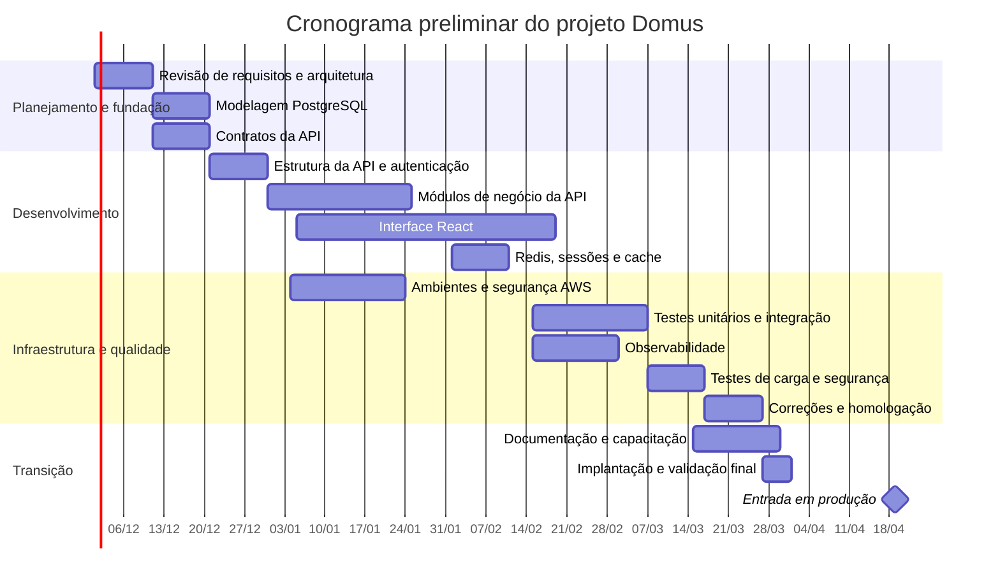

# PLANO.md — Plano de Projeto do Domus

> **Nota sobre as estimativas:** este plano é uma estimativa acadêmica preliminar. O repositório define tecnologias, requisitos e decisões arquiteturais, mas não apresenta orçamento aprovado, quantidade de profissionais contratados, volume real de dados ou propostas comerciais. Por isso, os valores e prazos abaixo são premissas de planejamento, não cotações de fornecedores.

---

## 1. Objetivo e premissas do projeto

O objetivo é planejar a construção, implantação e transição para operação do Domus, uma plataforma web de gestão de condomínios residenciais. O sistema centraliza atividades de administradores, síndicos, moradores e porteiros, incluindo cadastro de unidades, autorização de visitantes, comunicados, encomendas, reservas de áreas comuns, ocorrências e relatórios.

### 1.1 Arquitetura considerada

O plano parte dos seguintes elementos documentados na Etapa 1:

- **Cliente:** aplicação web responsiva em React, acessada pelo navegador.
- **Servidor:** API em Node.js com Express.
- **Banco de dados:** PostgreSQL relacional.
- **Cache e sessões:** Redis.
- **Comunicação:** HTTPS/JSON, com TLS 1.2 ou superior.
- **Infraestrutura proposta:** AWS, inicialmente com EC2 e RDS.
- **Módulos de negócio:** autenticação, reservas, comunicações e acesso a dados.
- **Perfis de usuário:** administrador, síndico, morador e porteiro.

### 1.2 Decisões arquiteturais que orientam o plano

| Decisão | Situação na Etapa 1 | Consequência para o projeto |
|---|---|---|
| ADR-001 — Aplicação web responsiva em React em vez de aplicativos nativos | Aceita | Uma única aplicação para navegadores; não será necessário desenvolver e manter versões nativas para Android e iOS. |
| ADR-002 — PostgreSQL em vez de banco não relacional | Aceita | Exige modelagem relacional, migrações, integridade referencial, testes de consultas e rotinas de backup. |
| ADR-003 — AWS (EC2 + RDS) em vez de servidor próprio | Proposta/recomendada, ainda não aprovada | O plano considera AWS como alternativa preferencial, mas prevê comparação de custo e validação antes da contratação. |
| Arquitetura cliente-servidor com API Node.js/Express | Definida nos diagramas C4 | Exige implementação, documentação, segurança e testes da API. |
| Redis para cache e sessões | Presente no diagrama de contêineres | Exige configuração, política de expiração, monitoramento e testes de consistência. |
| HTTPS/JSON e TLS 1.2+ | Definida na comunicação cliente-servidor | Exige certificado, configuração segura e testes de comunicação. |

**Limite de escopo:** a Etapa 1 não especifica provedor de envio de notificações, gateway de pagamento, aplicativo móvel nativo ou integração com sistemas externos. Esses itens não são considerados dependências obrigatórias deste plano.

### 1.3 Premissas de planejamento

1. O projeto será desenvolvido por uma equipe pequena, com dedicação parcial ou integral conforme o papel.
2. O prazo de referência é de aproximadamente **20 semanas**, contado a partir da autorização de início.
3. A primeira versão contemplará os requisitos funcionais RF01 a RF10 e as regras de negócio RN01 a RN05.
4. A infraestrutura AWS será validada por uma prova de conceito antes da contratação definitiva.
5. Os custos são apresentados em reais (R$), em valores estimados, sem compromisso comercial.
6. O dimensionamento inicial será validado por testes, considerando a meta de até 1.000 usuários simultâneos.
7. O plano não presume que a meta de 99,5% de disponibilidade esteja comprovada apenas pela escolha da AWS; ela deverá ser verificada na configuração implantada e na operação.

---

## 2. Escopo — Estrutura Analítica do Projeto (EAP)

A EAP decompõe as decisões arquiteturais em entregas e pacotes de trabalho. Os pacotes de transição — testes, observabilidade, migração, documentação e capacitação — também fazem parte do projeto.

### 2.1 EAP em três níveis

```mermaid
flowchart TD
    P["1.0 Projeto Domus"]

    P --> A["1.1 Planejamento e arquitetura"]
    A --> A1["1.1.1 Revisar requisitos, arquitetura e ADRs"]
    A --> A2["1.1.2 Definir ambientes e padrões técnicos"]

    P --> B["1.2 Aplicação web React"]
    B --> B1["1.2.1 Interface e navegação por perfil"]
    B --> B2["1.2.2 Telas de moradores e unidades"]
    B --> B3["1.2.3 Telas de visitantes, reservas e encomendas"]
    B --> B4["1.2.4 Telas de comunicados e ocorrências"]

    P --> C["1.3 API Node.js/Express"]
    C --> C1["1.3.1 Estrutura da API e autenticação"]
    C --> C2["1.3.2 Módulo de visitantes e autorizações"]
    C --> C3["1.3.3 Módulo de reservas e regras de negócio"]
    C --> C4["1.3.4 Módulo de comunicados, encomendas e ocorrências"]
    C --> C5["1.3.5 Relatórios e controle de permissões"]

    P --> D["1.4 Dados e persistência"]
    D --> D1["1.4.1 Modelagem relacional PostgreSQL"]
    D --> D2["1.4.2 Migrações, índices e integridade"]
    D --> D3["1.4.3 Redis para cache e sessões"]

    P --> E["1.5 Infraestrutura e segurança"]
    E --> E1["1.5.1 Preparar ambientes AWS ou ambiente de homologação"]
    E --> E2["1.5.2 Configurar HTTPS, TLS e segredos"]
    E --> E3["1.5.3 Backup, restauração e recuperação"]

    P --> F["1.6 Qualidade e transição"]
    F --> F1["1.6.1 Testes unitários e de integração"]
    F --> F2["1.6.2 Testes de carga e desempenho"]
    F --> F3["1.6.3 Observabilidade, logs e alertas"]
    F --> F4["1.6.4 Migração e validação dos dados iniciais"]
    F --> F5["1.6.5 Documentação e capacitação"]
    F --> F6["1.6.6 Homologação e entrada em produção"]
```

### 2.2 Pacotes principais, origem e entregas

| ID | Pacote de trabalho | Entrega verificável | Decisão/requisito de origem | Responsável principal |
|---|---|---|---|---|
| 1.1 | Planejamento e arquitetura | Backlog priorizado, ambientes e padrões definidos | Arquitetura cliente-servidor e requisitos da Etapa 1 | Gerente de projeto e arquiteto |
| 1.2 | Aplicação web React | Interface responsiva para os quatro perfis | ADR-001; RNF05; RF01–RF10 | Desenvolvedor front-end |
| 1.3 | API Node.js/Express | API REST documentada e módulos funcionais | C4 níveis 1–3; HTTPS/JSON; RF01–RF10 | Desenvolvedor back-end |
| 1.4 | Dados e persistência | PostgreSQL modelado, migrações e Redis configurado | ADR-002; diagrama de contêineres; RN03 e RN04 | DBA/engenheiro de dados e back-end |
| 1.5 | Infraestrutura e segurança | Ambientes, TLS, backups e procedimento de restauração | ADR-003; RNF02, RNF03 e RNF04 | DevOps/infraestrutura |
| 1.6 | Qualidade e transição | Relatórios de testes, monitoramento, dados iniciais, manuais e equipe capacitada | RNF01–RNF06 e consequências dos ADRs | QA, DevOps e gerente de projeto |

### 2.3 Pacote eliminado pela arquitetura

**Desenvolvimento de aplicativos nativos separados para Android e iOS.** A decisão ADR-001 pelo aplicativo web responsivo elimina duas codebases, dois ciclos de publicação em lojas e a manutenção de versões nativas distintas. A interface web deverá atender aos navegadores previstos no RNF05.

Também não será adquirido nem mantido um servidor físico próprio na alternativa AWS selecionada. Essa eliminação depende da aprovação da hospedagem em nuvem, que ainda aparece como proposta na Etapa 1.

---

## 3. Cronograma e caminho crítico

O cronograma abaixo considera início hipotético em **01/12/2026** e duração aproximada de 20 semanas. As datas deverão ser ajustadas quando houver uma data real de início e disponibilidade confirmada da equipe.

### 3.1 Dependências e justificativas

| Dependência | Justificativa arquitetural |
|---|---|
| Modelagem PostgreSQL antes dos módulos que persistem dados | O ADR-002 escolhe banco relacional; tabelas, chaves e restrições precisam estar definidas para que a API implemente as regras de negócio corretamente. |
| Estrutura da API antes da integração completa do React | O cliente web comunica-se com o servidor por HTTPS/JSON; os contratos dos endpoints precisam estar definidos para integração. |
| Autenticação e permissões antes das funcionalidades por perfil | Administrador, síndico, morador e porteiro possuem permissões diferentes. |
| PostgreSQL antes dos testes integrados de persistência | Os testes precisam validar transações, integridade referencial e regras RN03/RN04 no banco escolhido. |
| Redis depois da definição dos fluxos de sessão e cache | A política de expiração e os dados armazenados precisam ser definidos para evitar inconsistência de sessões ou informações. |
| HTTPS/TLS e infraestrutura antes da homologação externa | O RNF04 exige proteção das comunicações; a aplicação precisa ser testada no ambiente configurado. |
| Observabilidade antes dos testes de carga | Sem logs, métricas e alertas não é possível avaliar adequadamente desempenho, erros e consumo de recursos. |
| Testes de carga antes da entrada em produção | O RNF03 estabelece a meta de 1.000 usuários simultâneos e o RNF01 estabelece meta de tempo de resposta. |
| Capacitação e documentação antes da operação | A equipe responsável precisa conhecer implantação, backup, restauração, monitoramento e suporte. |

### 3.2 Caminho crítico

**Caminho crítico previsto:** planejamento e contratos técnicos → modelagem PostgreSQL → API e autenticação → integração dos módulos → testes integrados → testes de desempenho e segurança → homologação → implantação e transição.

Atrasos em qualquer uma dessas atividades podem adiar a entrada em produção. A interface React pode avançar em paralelo após a definição dos contratos da API. A preparação de infraestrutura, documentação operacional e parte da observabilidade também podem ocorrer em paralelo ao desenvolvimento, desde que suas dependências estejam definidas.

**Marcos principais:**

- **M1 — Arquitetura e backlog aprovados:** fim da semana 2.
- **M2 — Banco e contratos da API concluídos:** fim da semana 5.
- **M3 — Funcionalidades integradas:** fim da semana 13.
- **M4 — Testes e homologação aprovados:** fim da semana 18.
- **M5 — Entrada em produção e transição:** fim da semana 20.

### 3.3 Diagrama de Gantt

> O Gantt é uma linha de base preliminar em dias corridos aproximados. A estimativa PERT da seção 5 apresenta a incerteza dos pacotes; por isso, as durações do cronograma não devem ser interpretadas como garantias.

---

## 4. Custo em três anos

São comparadas duas alternativas de infraestrutura mencionadas na ADR-003:

- **Alternativa A — Servidor próprio:** compra de hardware, instalação e manutenção sob responsabilidade da equipe.
- **Alternativa B — AWS (EC2 + RDS):** infraestrutura em nuvem com cobrança recorrente e possibilidade de escalabilidade.

A ADR-003 recomenda inicialmente AWS, mas permanece como proposta. A comparação abaixo subsidia a decisão final.

### 4.1 Premissas financeiras

- Valores estimados em reais, para um ambiente inicial de produção e homologação.
- O custo de implantação inclui preparação do ambiente, configuração, segurança, automação e migração inicial.
- O custo anual de operação inclui infraestrutura, armazenamento, backup, tráfego e monitoramento básico.
- Os custos de desenvolvimento das funcionalidades são comuns às duas alternativas e, por isso, não são somados nesta comparação de infraestrutura.
- Não foram considerados impostos específicos, reajustes, variação cambial, grandes expansões de capacidade ou contratação de equipe exclusiva 24 horas.
- A estimativa deverá ser refinada com calculadora oficial da AWS e cotações de hardware antes de qualquer contratação.

### 4.2 Comparação

| Alternativa | Implantação | Operação por ano | Operação em 3 anos | Total em 3 anos |
|---|---:|---:|---:|---:|
| A — Servidor próprio | R$ 95.000 | R$ 28.000 | R$ 84.000 | **R$ 179.000** |
| B — AWS (EC2 + RDS) | R$ 48.000 | R$ 36.000 | R$ 108.000 | **R$ 156.000** |

**Cálculo do total:**

- Servidor próprio: R$ 95.000 + (3 × R$ 28.000) = **R$ 179.000**.
- AWS: R$ 48.000 + (3 × R$ 36.000) = **R$ 156.000**.

Pelas premissas adotadas, a AWS apresenta custo total estimado R$ 23.000 menor em três anos, além de reduzir a necessidade de compra e manutenção direta de hardware. O resultado não é universal: deve ser revisto caso o uso cresça muito, o câmbio aumente ou a infraestrutura própria já esteja disponível.

### 4.3 Alternativa selecionada

**Recomendação: iniciar com AWS (EC2 + RDS), condicionada à prova de conceito e à validação do custo mensal.**

A escolha acompanha a ADR-003 e favorece escalabilidade, backups gerenciados e menor esforço de manutenção física. Para reduzir o risco de dependência e de aumento de custos, o projeto deverá:

1. manter scripts de infraestrutura e configuração versionados;
2. documentar procedimentos de backup e restauração;
3. monitorar consumo e estabelecer alertas de orçamento;
4. manter o PostgreSQL como tecnologia de persistência, evitando dependência desnecessária de recursos exclusivos do fornecedor;
5. revisar mensalmente o custo e a capacidade contratada.

---

## 5. Estimativa dos pacotes — PERT

A estimativa PERT utiliza três cenários:

- **O (otimista):** execução sem impedimentos relevantes.
- **M (mais provável):** execução considerando dificuldades normais.
- **P (pessimista):** execução com retrabalho, integração difícil ou problemas técnicos plausíveis.

Fórmulas:

\[
PERT = \frac{O + 4M + P}{6}
\]

\[
Desvio \approx \frac{P-O}{6}
\]

As durações estão em **dias úteis** e representam esforço/duração estimada do pacote, não necessariamente dias consecutivos no calendário.

| Pacote principal | O | M | P | PERT | Desvio aproximado |
|---|---:|---:|---:|---:|---:|
| 1.1 Planejamento e arquitetura | 3 | 5 | 8 | 5,2 | 0,8 |
| 1.2 Aplicação web React | 15 | 22 | 35 | 23,0 | 3,3 |
| 1.3 API Node.js/Express | 18 | 28 | 45 | 29,8 | 4,5 |
| 1.4 PostgreSQL e Redis | 8 | 12 | 22 | 13,0 | 2,3 |
| 1.5 Infraestrutura e segurança | 6 | 10 | 20 | 11,0 | 2,3 |
| 1.6 Qualidade e transição | 12 | 18 | 30 | 19,0 | 3,0 |

### 5.1 Exemplo de cálculo — API Node.js/Express

Para o pacote 1.3:

- O = 18 dias;
- M = 28 dias;
- P = 45 dias.

\[
PERT = \frac{18 + 4(28) + 45}{6}
= \frac{175}{6}
= 29,2 \text{ dias}
\]

\[
Desvio \approx \frac{45-18}{6}
= 4,5 \text{ dias}
\]

A cauda pessimista está associada à integração entre autenticação, permissões, módulos de negócio e banco relacional, além de possíveis ajustes nas regras de negócio.

### 5.2 Relação entre incerteza e riscos

- **API:** risco de contratos incompletos ou mudanças de regras durante a integração.
- **React:** risco de retrabalho na interface responsiva e nos diferentes perfis de acesso.
- **PostgreSQL/Redis:** risco de modelagem inadequada, consultas lentas ou inconsistência de cache.
- **Infraestrutura:** risco de configuração incorreta, custo maior que o previsto ou dificuldade de atender à meta de disponibilidade.
- **Qualidade e transição:** risco de falhas descobertas apenas nos testes integrados ou de a equipe não estar preparada para operar o sistema.

Os valores PERT deverão ser atualizados após o primeiro ciclo de desenvolvimento, quando houver dados reais de produtividade.

---

## 6. Riscos

A tabela registra riscos arquiteturais, de projeto e de equipe. Cada risco possui resposta planejada e gatilho objetivo.

| ID | Risco e origem | Resposta planejada | Gatilho | Reserva |
|---|---|---|---|---|
| R1 | **Dependência da AWS e aumento de custos** — arquitetural | Mitigar: monitorar consumo, configurar alertas, documentar infraestrutura e evitar recursos proprietários desnecessários. | Custo mensal ultrapassar em 15% o orçamento previsto por dois meses consecutivos. | Contingência |
| R2 | **PostgreSQL não atender ao desempenho esperado** — arquitetural | Mitigar: revisar índices e consultas, executar testes de carga e ajustar recursos do banco. | Mais de 5% das requisições ultrapassarem 200 ms no teste representativo. | Contingência |
| R3 | **Cache Redis apresentar dados desatualizados ou sessões inconsistentes** — arquitetural | Mitigar: definir expiração, critérios de invalidação e testes de consistência; manter dados definitivos no PostgreSQL. | Teste identificar informação divergente entre cache e banco ou sessão inválida. | Contingência |
| R4 | **Atraso na integração entre React e API** — projeto | Mitigar: definir contratos de API antecipadamente, usar ambiente de integração e realizar reuniões curtas de alinhamento. | Endpoint prioritário ficar mais de cinco dias úteis sem contrato ou implementação disponível para integração. | Contingência |
| R5 | **Equipe sem experiência suficiente em AWS, Redis ou segurança web** — equipe | Mitigar: capacitação prática, documentação e apoio técnico pontual antes da implantação. | Profissional responsável não conseguir executar procedimento de implantação ou restauração em simulação. | Contingência |
| R6 | **Falha de segurança envolvendo dados pessoais** — arquitetural | Mitigar: TLS, controle de acesso por perfil, validação de entrada, gestão segura de segredos e testes de segurança. | Teste de segurança identificar vulnerabilidade crítica ou acesso indevido a dados de outro perfil/condomínio. | Contingência |
| R7 | **Atraso na contratação ou aprovação de serviços externos** — projeto | Mitigar: iniciar a avaliação e o processo de contratação antecipadamente; manter alternativa de homologação sem dependência comercial. | Serviço essencial não contratado ou aprovado até 30 dias antes da data planejada para homologação. | Contingência |
| R8 | **Perda ou corrupção de dados durante migração ou implantação** — projeto | Mitigar: backup anterior, ensaio de restauração, migração em ambiente de teste e plano de reversão. | Divergência na contagem ou integridade dos registros após ensaio de migração. | Contingência |

### 6.1 Reservas

- **Reserva de contingência:** reservar aproximadamente **10% do custo estimado de implantação** para respostas aos riscos identificados (R1 a R8). Essa reserva integra a linha de base do projeto e só será utilizada quando o gatilho de um risco ocorrer.
- **Reserva gerencial:** manter adicionalmente **5% do custo de implantação**, sob controle da direção do projeto, para eventos não identificados ou imprevistos. Não integra a linha de base e exige autorização específica.

Esses percentuais são premissas acadêmicas de planejamento e deverão ser revistos após a análise quantitativa dos riscos e a obtenção de cotações.

---

## 7. Aquisições — construir ou comprar

### 7.1 Decisão por componente

| Componente/serviço | Decisão | Justificativa |
|---|---|---|
| Interface React | Construir | É parte central do produto e precisa refletir os fluxos dos quatro perfis. |
| API Node.js/Express | Construir | Contém as regras de negócio específicas do Domus e integra os módulos do sistema. |
| Modelagem e consultas PostgreSQL | Construir | Estrutura própria para unidades, moradores, visitantes, reservas, encomendas e ocorrências. |
| Redis | Utilizar serviço/instância existente ou contratar serviço gerenciado após comparação | Evita implementar mecanismo de cache próprio; a decisão final depende de custo e operação. |
| Hospedagem AWS EC2 + RDS | Comprar/contratar serviço | A ADR-003 recomenda nuvem para escalabilidade, disponibilidade e redução da manutenção física. |
| Certificado TLS e domínio | Comprar/contratar quando necessário | São necessários para disponibilizar a aplicação com comunicação HTTPS. |
| Ferramentas de desenvolvimento e testes | Preferir ferramentas gratuitas ou já disponíveis | Reduz custo sem alterar a arquitetura definida. |

### 7.2 Prazo de contratação

O planejamento considera até **90 dias** para contratação de serviços quando houver processo de aquisição pública sujeito à Lei nº 14.133/2021, conforme a premissa indicada no enunciado da atividade. Esse prazo deve ser iniciado antecipadamente e não pode ser tratado como se fosse apenas o tempo técnico de configuração.

A aplicação da Lei nº 14.133/2021 depende de o contratante estar submetido ao regime de contratação pública. Em uma contratação privada, o prazo deverá seguir o processo interno e as condições comerciais do fornecedor.

### 7.3 Dependência de fornecedor e custo de saída

A alternativa AWS gera dependência operacional do provedor. Uma eventual saída exigiria:

- **Tempo:** estimativa preliminar de 4 a 8 semanas para provisionar outro ambiente, migrar dados, configurar segurança, testar e realizar a virada.
- **Dinheiro:** estimativa preliminar de R$ 15.000 a R$ 30.000 em esforço técnico e infraestrutura temporária, sem incluir eventuais multas ou custos contratuais.
- **Trabalho técnico:** recriar máquinas e redes, adaptar automações, migrar banco e backups, revisar monitoramento, ajustar configurações e testar desempenho.
- **O que tende a ser preservado:** aplicação React, API Node.js/Express e dados PostgreSQL, desde que sejam mantidos padrões portáveis e exportações testadas.
- **O que pode exigir reescrita ou adaptação:** automações específicas da AWS, políticas de infraestrutura, integração com serviços gerenciados e configurações de monitoramento.

Para reduzir o custo de saída, o projeto manterá scripts e documentação versionados, backups exportáveis e uso de PostgreSQL sem dependência desnecessária de extensões exclusivas.

---

## 8. Recursos humanos e responsabilidades

### 8.1 Papéis por pacote

| Papel | Responsabilidades | Pacotes |
|---|---|---|
| Gerente de projeto | Planejar atividades, acompanhar prazo, custo, riscos e comunicação | Todos; principalmente 1.1 e 1.6 |
| Arquiteto/analista de sistemas | Validar requisitos, decisões arquiteturais, contratos e integração | 1.1, 1.3 e 1.5 |
| Desenvolvedor front-end | Implementar interface React responsiva e integração com a API | 1.2 |
| Desenvolvedor back-end | Implementar API, autenticação, permissões e regras de negócio | 1.3 |
| DBA/engenheiro de dados | Modelar PostgreSQL, migrações, índices, backup e persistência | 1.4 e apoio a 1.6 |
| DevOps/infraestrutura | Configurar AWS, ambientes, TLS, Redis, logs, alertas e recuperação | 1.4, 1.5 e 1.6 |
| QA/testador | Planejar e executar testes unitários, integrados, de carga e segurança | 1.6 |
| Representante dos usuários | Validar fluxos de administrador, síndico, morador e porteiro | 1.1 e homologação de 1.6 |

Em uma equipe pequena, uma pessoa poderá acumular mais de um papel, desde que as responsabilidades estejam claras e que atividades críticas — como desenvolvimento e aprovação dos testes — tenham revisão adequada.

### 8.2 Quem opera depois da entrega

Após a implantação, a operação ficará organizada da seguinte forma:

- **DevOps/administrador de infraestrutura:** acompanha disponibilidade, consumo AWS, alertas, backups e restauração.
- **DBA/administrador do banco:** acompanha PostgreSQL, integridade, desempenho e rotinas de backup.
- **Suporte técnico:** recebe problemas de acesso e uso, classifica incidentes e encaminha falhas.
- **Administrador do sistema:** gerencia cadastros e permissões da plataforma.
- **Síndico:** administra informações e operações do respectivo condomínio.
- **Porteiro e morador:** utilizam as funcionalidades correspondentes aos seus perfis.

Os nomes das pessoas responsáveis deverão ser definidos pela organização na contratação ou formação da equipe. Como a Etapa 1 não informa nomes de profissionais, este plano identifica os papéis, sem inventar responsáveis individuais.

### 8.3 Lei de Brooks

Adicionar profissionais a uma atividade atrasada não garante sua aceleração. No Domus, novos integrantes precisariam compreender a arquitetura, os contratos da API, o modelo PostgreSQL e as regras de negócio. A integração e a comunicação poderiam aumentar o atraso.

A resposta planejada é priorizar funcionalidades, remover impedimentos e redistribuir tarefas independentes antes de aumentar a equipe.

### 8.4 Lei de Conway

A arquitetura do Domus possui módulos de autenticação, reservas, comunicações e acesso a dados. A organização da equipe deverá permitir comunicação entre front-end, back-end, dados e infraestrutura. Se cada área trabalhar isoladamente, podem surgir contratos incompatíveis e atrasos de integração.

Por isso, serão mantidos contratos de API documentados, revisão conjunta das decisões técnicas e reuniões de integração entre os responsáveis.

### 8.5 Capacitação

A capacitação será um pacote explícito do projeto, e não uma atividade informal.

| Capacitação | Público | Carga estimada | Custo estimado | Dependência |
|---|---|---:|---:|---|
| AWS, implantação e monitoramento | DevOps e arquiteto | 16 horas | R$ 2.000 | Antes da implantação |
| PostgreSQL, backup e restauração | DBA e back-end | 12 horas | R$ 1.200 | Antes da homologação |
| Redis e gestão de sessões/cache | Back-end e DevOps | 8 horas | R$ 800 | Antes dos testes integrados |
| Operação do sistema e suporte | Suporte, administrador e representantes dos usuários | 8 horas | R$ 600 | Antes da entrada em produção |
| **Total** |  | **44 horas** | **R$ 4.600** |  |

Os custos representam estimativa de instrutoria e material; não incluem salários regulares da equipe. A capacitação de operação e recuperação deve estar concluída antes da entrada em produção.

---

## 9. Controle, acompanhamento e critérios de aceite

O gerente de projeto acompanhará semanalmente:

- percentual de pacotes concluídos em relação à EAP;
- variação do cronograma e atividades do caminho crítico;
- custo realizado e previsão de custo total;
- riscos cujo gatilho tenha sido alcançado;
- defeitos críticos e pendências de homologação;
- consumo mensal da infraestrutura.

### 9.1 Critérios mínimos para entrada em produção

A implantação só será autorizada quando:

1. os requisitos RF01 a RF10 previstos para a versão forem testados e aceitos;
2. as regras RN01 a RN05 estiverem implementadas e validadas;
3. a comunicação estiver protegida por HTTPS/TLS 1.2 ou superior;
4. os testes verificarem a meta de desempenho do RNF01 e a capacidade prevista no RNF03;
5. houver procedimento de backup e restauração testado;
6. logs, métricas e alertas estiverem ativos;
7. os perfis e permissões tiverem sido homologados;
8. a documentação e a capacitação operacional estiverem concluídas;
9. houver plano de reversão para a implantação.

---

## 10. Rastreabilidade entre arquitetura e plano

| Elemento da Etapa 1 | Pacotes relacionados | Impacto no cronograma | Impacto em custo/risco |
|---|---|---|---|
| ADR-001 — React web responsivo | 1.2, 1.6 | Implementação de uma interface única e testes nos navegadores previstos | Elimina duas aplicações nativas; risco de compatibilidade web |
| ADR-002 — PostgreSQL | 1.3, 1.4, 1.6 | Modelagem precede persistência e testes integrados | Custo de modelagem/migração; risco de consultas lentas ou integridade inadequada |
| ADR-003 — AWS (proposta) | 1.5, 1.6 | Prova de conceito e preparação da infraestrutura antes da homologação | Custo recorrente; dependência de fornecedor e risco de variação de consumo |
| C4 — API Node.js/Express | 1.3 | Contratos e autenticação precedem integração dos módulos | Esforço de desenvolvimento e testes; risco de falha de integração |
| C4 — Redis para cache e sessões | 1.4, 1.6 | Configuração após definição dos fluxos de sessão/cache | Custo de operação; risco de dados desatualizados |
| HTTPS/JSON e TLS 1.2+ | 1.5, 1.6 | Configuração antes de homologação externa | Certificado/configuração; risco de exposição de dados |
| RNF01 — resposta inferior a 200 ms em 95% das requisições | 1.3, 1.4, 1.6 | Testes de desempenho após integração | Pode exigir otimização e recursos adicionais |
| RNF02 — disponibilidade de 99,5% | 1.5, 1.6 | Infraestrutura e recuperação antes da produção | Custo de redundância/serviços e risco de indisponibilidade |
| RNF03 — até 1.000 usuários simultâneos | 1.5, 1.6 | Teste de carga antes da implantação | Pode exigir ajuste de capacidade e escalabilidade |
| RNF04 — TLS 1.2+ | 1.5 | Segurança configurada antes da homologação | Certificados e configuração segura |
| RF01–RF10 e RN01–RN05 | 1.2, 1.3, 1.4, 1.6 | Desenvolvimento, integração e homologação | Esforço de implementação e risco de regras incorretas |

---
