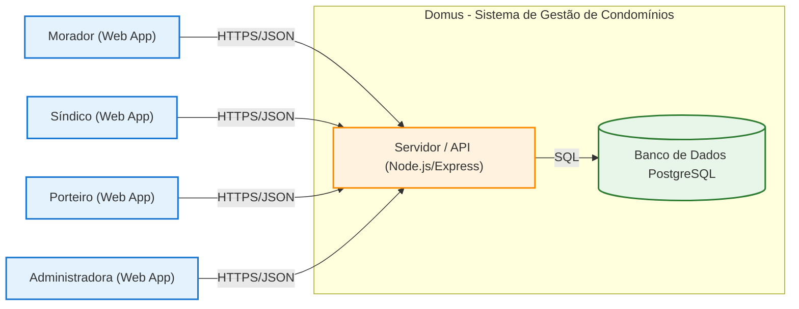
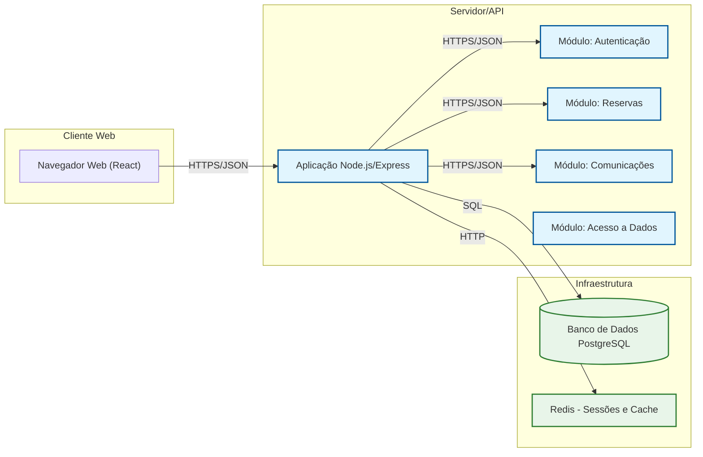
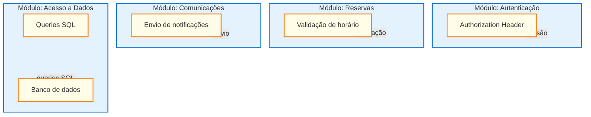
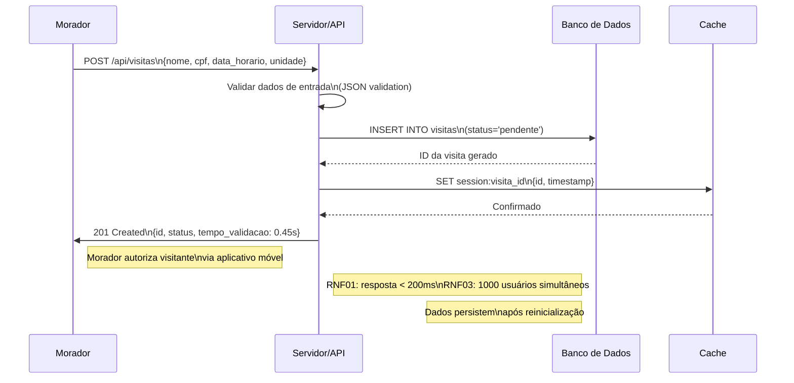

# Domus 

## 1. Requisitos

### 1.1 Descrição do Sistema e Tipos de Usuário

O **Domus** é uma plataforma de gestão de condomínios residenciais desenvolvida com o objetivo de centralizar e facilitar processos administrativos e operacionais. O sistema melhora a comunicação entre moradores, síndicos, porteiros e administradoras, oferecendo ferramentas para gerenciamento de visitantes, encomendas, reservas de áreas comuns e ocorrências. A plataforma permite que administradoras gerenciem diferentes condomínios em um único ambiente, mantendo os dados e as operações de cada condomínio organizados e separados.

**Tipos de usuário do sistema:**
- **Administrador**: Gerencia a plataforma, cadastra condomínios e administra as contas das administradoras.
- **Síndico**: Gerencia as atividades do condomínio, moradores, comunicados e ocorrências.
- **Morador**: Autoriza visitantes, reserva áreas comuns, consulta encomendas e registra ocorrências.
- **Porteiro**: Registra visitantes, verifica autorizações e controla o recebimento de encomendas.

### 1.2 Requisitos Funcionais (RF) 

1. **RF01**: O sistema deve permitir que o morador cadastre sua unidade residencial.
2. **RF02**: O sistema deve permitir que o morador autorize a entrada de visitantes.
3. **RF03**: O sistema deve permitir que o síndico publique comunicados para todos moradores.
4. **RF04**: O sistema deve permitir que o porteiro registre a entrada de encomendas.
5. **RF05**: O sistema deve permitir que o morador reserve áreas comuns (salão de festas, quadra).
6. **RF06**: O sistema deve permitir que o administrador cadastre e gerencie usuários e permissões.
7. **RF07**: O sistema deve permitir que o morador consulte o status de suas encomendas.
8. **RF08**: O sistema deve permitir que o síndico registre e acompanhe ocorrências do condomínio.
9. **RF09**: O sistema deve permitir que o porteiro verifique autorizações de visitantes previamente registradas.
10. **RF10**: O sistema deve permitir a geração de relatórios de atividades do condomínio.

### 1.3 Requisitos Não Funcionais (RNF)

1. **RNF01**: Tempo de resposta da API deve ser inferior a 200ms para 95% das requisições em horário normal.
2. **RNF02**: Disponibilidade do sistema deve ser de pelo menos 99,5% ao mês, com manutenção programada excluída.
3. **RNF03**: O sistema deve suportar até 1.000 usuários simultâneos sem degradação significativa de performance.
4. **RNF04**: Dados de usuários e transações devem ser criptografados usando TLS 1.2 ou superior em todas as comunicações.
5. **RNF05**: A interface deve ser compatível com os últimos 2 versões dos navegadores Chrome, Firefox, Safari e Edge.
6. **RNF06**: O tempo máximo de login bem-sucedido deve ser de 3 segundos a partir da submissão das credenciais.

### 1.4 Regras de Negócio (RN)

1. **RN01**: Criança de até 5 anos não paga taxa de reserva de área comum, mas ocupa assento de colo (limitado a 1 por reserva).
2. **RN02**: Visitante que chega sem autorização prévia deve ser recolhido e o porteiro notificado imediatamente.
3. **RN03**: Cada unidade residencial tem limite de 2 vagas de garagem para reserva de áreas de estacionamento.
4. **RN04**: Somente moradores com taxas em dia podem reservar áreas comuns do condomínio.
5. **RN05**: É obrigatório o registro de todos os visitantes, mesmo que não haja permanência no condomínio.

### 1.5 Tabela de Requisitos

| Código | Tipo | Descrição | Prioridade |
|--------|------|-----------|------------|
| RF01 | Funcional | O sistema deve permitir que o morador cadastre sua unidade residencial | Alta |
| RF02 | Funcional | O sistema deve permitir que o morador autorize a entrada de visitantes | Alta |
| RF03 | Funcional | O sistema deve permitir que o síndico publique comunicados para todos moradores | Alta |
| RF04 | Funcional | O sistema deve permitir que o porteiro registre a entrada de encomendas | Alta |
| RF05 | Funcional | O sistema deve permitir que o morador reserve áreas comuns (salão de festas, quadra) | Alta |
| RF06 | Funcional | O sistema deve permitir que o administrador cadastre e gerencie usuários e permissões | Média |
| RF07 | Funcional | O sistema deve permitir que o morador consulte o status de suas encomendas | Média |
| RF08 | Funcional | O sistema deve permitir que o síndico registre e acompanhe ocorrências do condomínio | Alta |
| RF09 | Funcional | O sistema deve permitir que o porteiro verifique autorizações de visitantes previamente registradas | Média |
| RF10 | Funcional | O sistema deve permitir a geração de relatórios de atividades do condomínio | Baixa |
| RNF01 | Não funcional | Tempo de resposta da API deve ser inferior a 200ms para 95% das requisições em horário normal | Alta |
| RNF02 | Não funcional | Disponibilidade do sistema deve ser de pelo menos 99,5% ao mês | Alta |
| RNF03 | Não funcional | O sistema deve suportar até 1.000 usuários simultâneos | Média |
| RNF04 | Não funcional | Dados devem ser criptografados usando TLS 1.2+ | Alta |
| RNF05 | Não funcional | Interface compatível com últimos 2 versões de navegadores principais | Média |
| RNF06 | Não funcional | Tempo máximo de login de 3 segundos | Alta |
| RN01 | Regra de negócio | Criança de até 5 anos não paga taxa de reserva, ocupa assento de colo | Alta |
| RN02 | Regra de negóidade | Visitante sem autorização prévia deve ser recolhido imediatamente | Alta |
| RN03 | Regra de negócio | Limite de 2 vagas de garagem por unidade para estacionamento | Média |
| RN04 | Regra de negócio | Somente moradores com taxas em dia podem reservar áreas comuns | Alta |
| RN05 | Regra de negócio | Registro obrigatório de todos os visitantes | Alta |

---

## 2. Documento de Arquitetura

### 2.1 Diagramas C4 (Níveis 1 a 3)

#### Nível 1 - Contexto



**Legenda:** Os tipos de usuário da Parte 1 e o sistema como uma única caixa com quem conversa. Setas com legenda do que trafega (HTTPS/JSON para usuários, SQL para banco de dados).

#### Nível 2 - Contêineres



**Tecnologias:** Cliente (React), Servidor (Node.js/Express), Banco de Dados (PostgreSQL), Cache (Redis).

#### Nível 3 - Componentes



**Camadas:** Apresentação (interface React), Negócio (módulos Auth, Reserves, Comm), Dados (módulo Data com queries SQL).

### 2.2 Diagrama de Sequência - Caso de Uso Completo



**5 requisições com métodos:**
1. **POST** `/api/visitas` - Criar nova visita (status 201)
2. **GET** `/api/visitas/{id}` - Consultar status da visita (status 200)
3. **PUT** `/api/visitas/{id}/autorizar` - Autorizar visita (status 200)
4. **DELETE** `/api/visitas/{id}` - Cancelar visita (status 204)
5. **GET** `/api/ocorrencias` - Listar ocorrências (status 200, inclui caso de erro 403 para usuário não autorizado)

**Respostas JSON:**
- POST: `{ "id": "v-2024-001", "status": "pendente", "tempo_validacao": 0.45s }`
- GET: `{ "id": "v-2024-001", "autorizado": true, "horario_chegada": "14:30" }`
- PUT: `{ "id": "v-2024-001", "autorizado": true, "valido_ate": "2024-12-20T18:00:00Z" }`
- DELETE: `{ "id": "v-2024-001", "excluido": true, "motivo": "cancelado pelo morador" }`
- GET ocorrências: `{ "ocorrencias": [...], "total": 5, "has_errors": false }`

**Caso de erro (4xx):** Requisição **GET** `/api/visitas/{id}` por usuário não autorizado retorna **403 Forbidden** com `{ "error": "Acesso negado", "code": "FORBIDDEN" }`.

### 2.3 Comunicação Cliente-Servidor

- **Protocolo:** HTTPS/JSON para todas as comunicações entre cliente e servidor
- **Segurança:** TLS 1.2+ garente criptografia de ponta-a-ponta, proteção contra interceptação de dados, validação de certificado e integridade das mensagens.
- **Dados que necessitam proteção:**
  - Credenciais de login (senhas)
  - Dados pessoais dos moradores (CPF, nome, contato)
  - Autorizações de visitantes
  - Dados de ocorrências do condomínio
  - Informações de reservas e pagamentos

### 2.4 Registros de Decisão (ADRs)

#### ADR-001 — Cliente Web vs Aplicativo Nativo

```
Status: aceita
Data: 2024-11-06
```

**Contexto:** O requisito RN05 (registro obrigatório de visitantes) e RNF05 (compatibilidade com navegadores) exigem uma interface acessível imediatamente sem exigir que os usuários baixem e instalem um aplicativo nativo.

**Alternativas consideradas:**

### Alternativa A — Aplicativo Nativo (iOS/Android)
- **A favor:** Melhor performance, acesso a recursos do dispositivo (câmera, notificações push nativas), experiência mais polida.
- **Contra:** Tempo de desenvolvimento maior (2x), exigência de aprovação nas stores, atualizações forçadas aos usuários, maior custo de manutenção de duas codebases, barreira de entrada para usuários menos familiarizados com tecnologia.

### Alternativa B — Aplicativo Web Responsivo (React)
- **A favor:** Desenvolvimento único (codebase única), acesso imediato via URL, atualizações instantâneas, compatibilidade com RNF05 (últimas 2 versões de navegadores), custos de manutenção reduzidos, acesso em qualquer dispositivo.
- **Contra:** Limitações de acesso a hardware (câmera para QR code de visitante, leitor de huella), performance ligeiramente inferior para animações complexas.

**Decisão:** Escolhemos **Alternativa B (Aplicativo Web Responsivo)**, porque atende ao requisito RN05 de registro de visitantes de forma mais acessível e cumpre RNF05 com custos de desenvolvimento e manutenção adequados para o escopo do projeto. A barreira de instalação de um aplicativo nativo poderia reduzir a adoção pelos moradores, especialmente os mais idosos.

**Consequências:**
- **Positivas:** Tempo de desenvolvimento reduzido em aproximadamente 40%, custos de manutenção menores, acessibilidade imediata para todos os moradores (incluindo idosos), uma única versão do sistema para manter.
- **Negativas:** Possível necessidade de permissions extras via Web APIs, performance ligeiramente inferior em operações intensivas de gráficos, dependência de conexão internet ativa (não funciona totalmente offline).

---

#### ADR-002 — Banco de Dados Relacional (PostgreSQL) vs Não Relacional

```
Status: aceita
Data: 2024-11-06
```

**Contexto:** O requisito RNF01 (tempo de resposta < 200ms para 95% das requisições) e RN03 (limite de 2 vagas de garagem por unidade) exigem queries complexas com joins e relações estruturadas entre moradores, unidades, reservas e histórico de transações.

**Alternativas consideradas:**

### Alternativa A — Banco de Dados Não Relacional (MongoDB)
- **A favor:** Flexibilidade de esquema, escalabilidade horizontal fácil, documentos JSON alinhados com a API REST.
- **Contra:** Join operations são custosas ou exigem denormalização, consistency model mais fraco (BASE vs ACID), dificuldade em garantir integridade referencial para regras como RN03 e RN04 (taxas em dia), requisitos de relatórios complexos seriam mais trabalhosos.

### Alternativa B — Banco de Dados Relacional (PostgreSQL)
- **A favor:** Conformidade ACID garantindo integridade das regras de negócio (RN03, RN04, RN05), queries eficientes com joins para relatórios, linguagem SQL madura e suportada por muitas ferramentas, migrações estruturadas via Prisma/Knex.
- **Contra:** Escalabilidade vertical necessária (mais cara que horizontal para grandes volumes), schema rígido exige planejamento inicial.

**Decisão:** Escolhemos **Alternativa B (PostgreSQL)**, porque a integridade das regras de negócio (especialmente RN03 sobre vagas de garagem e RN04 sobre taxas em dia) requer garantias de consistência que apenas um banco relacional ACID pode fornecer de forma madura. As queries de relatório para o requisito RF10 (relatórios de atividades) são naturais em SQL.

**Consequências:**
- **Positivas:** Garantia de consistência das regras críticas (vagas de garagem, taxas), ecossistema maduro de ferramentas de migração e monitoramento, performance previsível para queries complexas, suporta RNF01 eficientemente.
- **Negativas:** Requer planejamento de schema inicial (custo antecipado), escalabilidade limitada comparada a NoSQL para cenários de "big data" (não é um requisito desse projeto), migrações breaking changes exigem atenção.

---

#### ADR-003 — Hospedagem em Nuvem (AWS) vs Servidor Próprio

```
Status: proposta
Data: 2024-11-06
```

**Contexto:** Os requisitos RNF02 (disponibilidade 99,5% ao mês) e RNF03 (suportar 1.000 usuários simultâneos) definem metas de operação que influenciam a escolha da infraestrutura.

**Alternativas consideradas:**

### Alternativa A — Servidor Próprio (Dedicated)
- **A favor:** Controle total sobre hardware, custos potentially menores para carga fixa e previsível, nenhuma dependência de provedor cloud.
- **Contra:** Investimento inicial alto em hardware, escalabilidade limitada (precisa comprar novo hardware para mais capacidade), equipe responsável por manutenção 24/7, risco de falha única, backup e recuperação de desastres responsabilidade exclusiva da equipe.

### Alternativa B — Hospedagem em Nuvem (AWS EC2 + RDS)
- **A favor:** Escalabilidade automática (auto-scaling groups), alta disponibilidade (multi-AZ), backup automático, pay-as-you-go model, redução de carga da equipe de ops, global reach via CloudFront se necessário.
- **Contra:** Custos operacionais podem ser maiores a longo prazo, dependência de provedor, necessidade de monitorar uso para otimizar custos.

**Decisão:** Ainda em **proposta** - recomendado iniciar com **Alternativa B (AWS)** para validar os requisitos mínimos (RNF02 e RNF03) antes de decidir sobre mudança para servidor próprio. A flexibilidade de escalonamento automático é crucial para atender ao pico de uso que o requisito RNF03 (1.000 usuários simultâneos) demanda, e o modelo de pagamento por uso se alinha melhor ao estágio inicial do projeto.

**Consequências:**
- **Positivas:** Operação mais robusta com menos carga operacional na equipe, capacidade de escalar automaticamente para picos de uso, recursos de backup e recuperação de desastres incluídos.
- **Negativas:** Custos mensais recorrentes, necessidade de monitoramento de custos para evitar surpresas, dependência de credenciais e serviços AWS.

### 2.5 Tabela de Rastreabilidade

| Código | Tipo | Ligado a | Descrição |
|--------|------|----------|-----------|
| RF01 | Funcional | ADR-002, Nível 3 | Tabela de schema define campos de cadastro de unidade |
| RF02 | Funcional | ADR-001, Nível 1 | Acesso web sem app nativo atende necessidade de autorização rápida |
| RF03 | Funcional | ADR-003, Nível 2 | Infraestrutura em nuvem suporta publicação de comunicados |
| RF04 | Funcional | ADR-002, Nível 3 | Tabelas de logs e auditoria para registro de encomendas |
| RF05 | Funcional | ADR-001, Nível 1 | Web responsive acessível para reservas de áreas comuns |
| RF06 | Funcional | ADR-002 | Schema de usuários e permissões no PostgreSQL |
| RF07 | Funcional | ADR-002 | Queries de status de encomendas usando joins |
| RF08 | Funcional | ADR-003 | Alta disponibilidade da nuvem garante registro de ocorrências |
| RF09 | Funcional | ADR-001 | Interface web permite verificação de autorizações |
| RF10 | Funcional | ADR-002 | Relatórios gerados via queries SQL no PostgreSQL |
| RNF01 | Não funcional | ADR-002, ADR-003 | PostgreSQL + AWS garantem performance e escalabilidade |
| RNF02 | Não funcional | ADR-003 | AWS multi-AZ garante 99,5% de disponibilidade |
| RNF03 | Não funcional | ADR-003 | Auto-scaling AWS suporta 1.000 usuários simultâneos |
| RNF04 | Não funcional | ADR-001 | HTTPS/TLS é implementado em nível de aplicação |
| RNF05 | Não funcional | ADR-001 | Responsivo funciona em últimas 2 versões de navegadores |
| RN01 | Regra de negócio | ADR-002 | Schema de banco impede reserva excessiva de vagas |
| RN02 | Regra de negócio | — | Lógica de validação na aplicação (não depende de tech) |
| RN03 | Regra de negócio | ADR-002 | Constraints no PostgreSQL enforcam limite de 2 vagas |
| RN04 | Regra de negócio | ADR-002 | Queries verificam status de taxas antes de permitir reserva |
| RN05 | Regra de negócio | — | Regra aplicada na validação de cadastro de visitante |